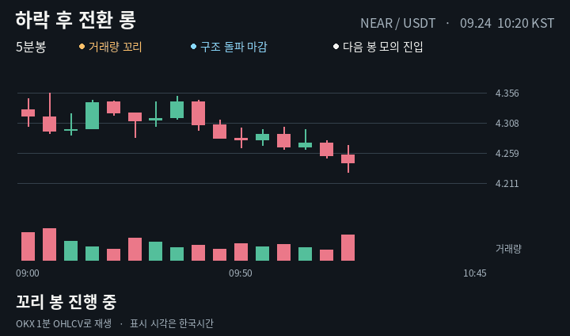

# 거래량이 붙은 꼬리 이후의 전환과 추세 재개

15분봉으로 기존 추세를 확인하고, 5분봉 꼬리에서 후보를 찾았습니다. 같은 꼬리 이후 어느 봉에서 실제 진입을 허용할지를 비교했습니다. 최근 60일 모의계좌에서 가장 먼저 고정한 네 규칙을 함께 쓰면 150 USDT가 138.26 USDT가 됐습니다. 실거래 배포 기준인 개별·합산 순수익 +10%를 통과한 후보는 없었습니다.



각 장면은 60일 합산 계좌에서 꼬리 봉과 확인 봉이 분리된 해당 규칙의 첫 거래입니다. 노란 원은 거래량이 붙은 꼬리, 하늘색 네모는 기준선을 돌파한 종가, 흰 삼각형은 다음 봉의 모의 체결가입니다. 한 프레임에 1분씩 진행하며 그때까지 집계한 거래량과 가격을 표시합니다.

## 5분봉으로 확인한 타점

| 후보 | 진입을 관찰한 순서 | 고정 진입 시간·한국시간 | 최근 60일 거래 | 150 USDT 단독 계좌 순수익률 |
| --- | --- | --- | ---: | ---: |
| 하락 후 전환 롱 | 하락 → 거래량을 동반한 아랫꼬리 → 직전 반등 고점 위 종가 | 08~16시 | 17 | −2.23% |
| 상승 후 전환 숏 | 상승 → 거래량을 동반한 윗꼬리 → 직전 눌림 저점 아래 종가 | 20~24시 | 8 | −0.33% |
| 상승 추세 눌림 롱 | 상승 추세 → EMA20 부근 눌림과 아랫꼬리 → 눌림 구간 고점 회복 | 00~04시 | 4 | −0.69% |
| 하락 추세 반등 숏 | 하락 추세 → EMA20 부근 반등과 윗꼬리 → 반등 구간 저점 재이탈 | 16~24시 | 25 | −4.78% |

네 후보에서 선택된 꼬리는 전체 봉 범위의 1/3 이상이었고 거래량은 직전 20개 완료봉 평균의 1.5배 이상이면서 직전 봉보다 많았습니다. 전환 롱에서는 꼬리가 생기기 전 15분 EMA20이 내려가고 있어야 했습니다. 추세 재개 롱에서는 15분 EMA20이 EMA50 위에서 상승하고 종가도 EMA20 위에 있어야 했습니다. 두 숏 규칙에서는 모든 가격 방향을 뒤집었습니다. 거래량 기준은 양방향에 동일하게 적용했습니다.

전환의 기준선은 꼬리가 생기기 전에 양옆 두 봉이 마감되어 이미 확인된 최근 5분봉 반등 고점이나 눌림 저점입니다. 추세 재개의 기준선은 꼬리 봉을 포함한 최근 3개 5분봉 고점이나 저점입니다. 기준선을 돌파한 종가에서 거래량·몸통과 과도한 추격 여부를 확인한 뒤 다음 1분봉 시가로 체결을 모의했습니다.

## 같은 설정에서 확인 속도 비교

| 계좌마다 함께 사용한 네 규칙 | 모의 거래 수 | 최종 잔액 | 순수익률 |
| --- | ---: | ---: | ---: |
| 5분봉 종가의 구조 돌파 | 54 | 138.26 USDT | −7.83% |
| 같은 구조를 1분봉 종가에서 먼저 돌파 | 107 | 132.83 USDT | −11.45% |
| 1분 저점 상승·고점 하락과 작은 반등 고점·눌림 저점 돌파 | 91 | 124.84 USDT | −16.78% |

진입 기준을 바꾸면 발생하는 거래와 빈도도 달라집니다. 5분봉 돌파로 들어간 54건 중 진입 다음 15분 동안 종가가 진입 방향으로 움직인 거래는 20건이었습니다. 여기서는 조기 청산한 거래도 동일하게 진입 15분 뒤의 시장가격으로 측정했습니다. 예시의 고점·저점과 거래량은 다음에 올 가격을 알 수 없던 시점의 자료입니다.

## 검증 조건

한국시간 2026년 9월 22일~11월 20일, OKX USDT 무기한 알트코인 31종목의 완료된 1분봉 2,678,400개와 정산 펀딩 이력을 사용했습니다. 신호당 증거금 상한은 가용 기준액의 10%, 거래당 위험 예산은 0.5%, 합산 위험 예산은 2%였습니다. 최초 손절은 원래 꼬리 밖에 뒀고, 1R부터 추적손절을 사용했습니다. 수수료와 슬리피지는 각각 편도 0.05%로 잡았습니다. 결과는 과거 호가 대기열·실제 계좌 체결을 근사한 값입니다.

3월과 5월에 시작한 두 60일 구간에서 5분봉 진입의 480개 시간·거래량·확인·보유시간 조합을 비교했습니다. 7월 1일~8월 29일 중간 검증을 거쳐 규칙별 설정을 하나 고정했습니다. 중간 검증을 통과한 규칙이 없어 표는 비교용입니다. 1~2월 재현과 최근 구간의 슬리피지 두 배·종가 추적 조건도 별도로 계산했습니다. 1분 진입은 5분 결과를 본 뒤 같은 시간대와 위험 조건으로 추가 비교한 탐색적 결과입니다. 최근 60일 시세는 이전 연구에서도 검토했습니다.

## 재현

같은 저장소의 `desktop/research/pc250/timing_research`, PC 2.5.0 배포 ZIP의 `OKX_PC_PACKAGE`, `desktop/research/target10_20261121/replay.zip`을 기존 연구의 안내대로 준비합니다. 그 작업 디렉터리에 [timing_review.zip](./timing_review.zip)을 풀면 이번 연구 코드, 고정 설정, 구간별 성과와 거래 장부가 들어 있습니다.

새로 마감한 60일을 검증할 때 종료일은 한국시간 0시이며 그날은 제외합니다. 아래 명령에 확인할 종료일을 넣습니다.

```bash
python turning_review/forward.py --end 2026-11-21 --fetch
```

공개 자료는 [OKX 과거 시장 데이터](https://www.okx.com/historical-data)에서 확인할 수 있습니다.
