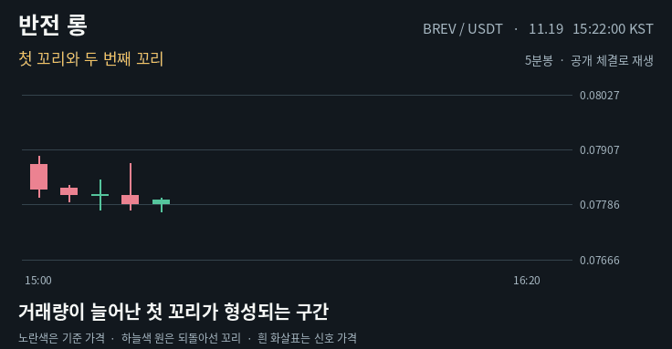

# 두 번째 꼬리와 이평선 반등에서 진입

직전 고점이나 저점의 돌파를 기다리던 판정을 사용자 설명에 맞춰 고쳤습니다. 한국시간 2026년 9월 22일부터 11월 20일까지 60일 동안 OKX USDT 무기한 알트코인 31종목에서 네 후보를 함께 모의 거래했습니다. 시작 자금 150 USDT가 38.96 USDT가 됐습니다. 수익률은 −74.03%였으며 PC 2.5.0의 실거래 배포 기준인 규칙별·합산 순수익 +10%에 미달했습니다.



영상의 노란색은 첫 꼬리 가격이나 5분 EMA20이고, 하늘색 원은 되돌아선 꼬리입니다. 흰 화살표가 신호가 나온 가격을 가리킵니다. 4종목 표본 계좌의 모의 거래에서 11월 17~19일자 공개 체결 파일에 들어 있는 BREV 반전 롱, INIT 반전 숏, BONK 눌림 롱, LINK 반등 숏의 첫 사례를 시간순으로 선택했습니다. 영상 속 시세는 실제 체결 기록이고 모의 주문가는 비용 가정을 반영합니다.

## 어디서 신호가 나오는가

| 유형 | 지켜보는 가격 | 진입 타점 |
| --- | --- | --- |
| 반전 롱 | 하락하던 종목에서 거래량이 붙은 첫 아랫꼬리 저점 | 가격이 한 번 벗어난 뒤 다음 꼬리가 첫 저점 가까이에서 더 높은 저점을 만들고 튀는 첫 움직임 |
| 반전 숏 | 상승하던 종목에서 거래량이 붙은 첫 윗꼬리 고점 | 가격이 한 번 벗어난 뒤 다음 꼬리가 첫 고점 가까이에서 더 낮은 고점을 만들고 밀리는 첫 움직임 |
| 추세 눌림 롱 | 상승 추세에서 가격이 위에서 접근하는 이평선 | 이평선에 닿아 짧은 아랫꼬리가 생기면서 매수 방향으로 되돌아서는 순간 |
| 추세 반등 숏 | 하락 추세에서 가격이 아래에서 접근하는 이평선 | 이평선에 닿아 짧은 윗꼬리가 생기면서 매도 방향으로 되돌아서는 순간 |

추세의 배경은 15분 완료봉으로, 첫 꼬리는 5분봉으로 평가했습니다. 첫 꼬리의 거래량은 직전 20개 봉 평균의 1.5배 이상이면서 직전 봉보다 커야 했습니다. 반전 후보에서는 첫 꼬리에서 가격이 벗어났다가 3시간 이내에 다시 방문하는 경우를 측정했습니다. 두 번째 저점은 첫 저점보다 최소 한 호가 높고 두 번째 고점은 첫 고점보다 최소 한 호가 낮아야 합니다.

이번 검증에서 이평선은 마지막으로 마감한 5분봉의 EMA20으로 정했습니다. 이평선에 한 호가 이내로 닿고 반대편 침투가 제한되는 경우를 관찰했습니다. ‘근처’는 변동성에 따라 5분 평균진폭(ATR)의 0.20배 또는 0.35배, 최소 세 호가로 놓았습니다. ‘움직이기 시작한 순간’은 한 호가 또는 두 호가가 유리한 쪽으로 되돌아선 첫 체결로 측정했습니다. 큰 폭으로 건너뛴 가격을 추격하는 신호는 제외했습니다. 이 숫자들은 사용자 설명을 시험하기 위한 가정입니다.

## 최근 60일의 공개 체결 기반 모의 성과

| 150 USDT 단독 계좌 | 진입 시간·한국시간 | 거래 수 | 최종 USDT | 순수익률 | 슬리피지 두 배 |
| --- | --- | ---: | ---: | ---: | ---: |
| 반전 롱 | 16~20시 | 213 | 103.87 | −30.76% | −40.80% |
| 반전 숏 | 12~16시 | 185 | 118.67 | −20.89% | −27.69% |
| 추세 눌림 롱 | 08~12시 | 216 | 96.00 | −36.00% | −43.24% |
| 추세 반등 숏 | 00~04시 | 215 | 107.24 | −28.51% | −37.70% |

| 네 규칙이 150 USDT를 공유한 경우 | 거래 수 | 최종 USDT | 순수익률 |
| --- | ---: | ---: | ---: |
| 공개 체결 순서 | 829 | 38.96 | −74.03% |
| 공개 체결 순서 · 슬리피지 두 배 | 826 | 24.81 | −83.46% |
| 동일한 최근 60일을 1분봉으로 근사 | 700 | 47.25 | −68.50% |
| 1월 1일~3월 1일 별도 60일 · 1분봉 근사 | 645 | 50.17 | −66.56% |

합산 계좌 829건의 같은 체결 시점과 수량으로 나눠 보면, 공개 체결가 간의 가격 차익은 +11.11 USDT, 모의 수수료는 −61.05 USDT, 모의 슬리피지는 −61.05 USDT, 펀딩은 -0.04 USDT였습니다. 진입·청산 비용을 감당하기에 가격 차익이 작았습니다.

수수료는 편도 0.05%, 슬리피지는 편도 0.05%를 가정했고 과거 정산 펀딩을 반영했습니다. 슬리피지 스트레스는 편도 0.10%입니다. 증거금 상한은 가용 기준액의 10%, 거래당 위험 예산은 0.5%, 전체 동시 위험 예산은 2%였습니다. 150 USDT 중 3 USDT를 남기고 거래소 계약 단위로 수량을 내림했습니다. 최초 손절은 해당 구조 밖, 추적손절은 최초 위험폭만큼 유리하게 움직인 뒤 전량에 적용했습니다. 보유 만료는 45분 또는 120분이며 고정 부분익절은 없습니다.

공개 체결 자료를 시간과 거래 ID 순서로 읽었습니다. 31종목에 걸쳐 신호 대기·보유가 가능했던 구간의 거래 213,329,260건을 처리했고, 거래량이 있었던 해당 1분봉 725,999개의 고가·저가와 대조했습니다. 주문을 보냈다고 가정한 뒤 다음 밀리초 이후의 첫 공개 체결가에 슬리피지를 더해 모의 체결했습니다. 급격한 불리한 움직임도 손익에 포함했습니다. 호가 잔량, 개별 계좌 지연과 부분 체결은 재현하지 않았습니다.

시간대와 조건 조합 144개를 3월 3일~5월 1일 및 5월 2일~6월 30일 자료로 비교하고, 7월 1일~8월 29일 자료로 규칙마다 설정 하나를 골랐습니다. 이 선택에는 1분봉 근사를 사용했습니다. 최근 60일은 이렇게 고정한 네 설정의 체결 단위 성과를 확인하는 데 썼습니다. 같은 날짜들이 종전 연구에도 쓰였고 개발 단계에서 네 후보 모두 사전 수익성 기준에 미달했습니다.

## 재현 파일

[재현 코드·고정 설정·결과와 모의 거래 장부](./wick_touch.zip)

기존 저장소의 [PC 2.5.0 연구 코드](../pc250/timing_research)와 [검증 패키지](../target10_20261121/replay.zip), PC 2.5.0 배포 ZIP 안의 `OKX_PC_PACKAGE`를 같은 디렉터리에 준비하고 `wick_touch.zip`을 풉니다. 시작 시 데이터가 비어 있으면 해당 기간의 공개 분봉과 펀딩을 받고 1분·5분·15분 배열과 계약 규격을 먼저 준비합니다. 기존 `target_research/reproduce.py --fetch`가 이 자료를 준비합니다. g++ 및 NumPy, pandas가 필요합니다.

```bash
python target_research/paths.py compile
python wick_touch_review/experiment.py build development
python wick_touch_review/experiment.py freeze
python wick_touch_review/experiment.py build recent
python wick_touch_review/experiment.py evaluate recent
python wick_touch_review/experiment.py build earlier
python wick_touch_review/experiment.py evaluate earlier
python wick_touch_review/tick_inputs.py --symbols all
python wick_touch_review/tick_replay.py --symbols all --workers 4
python wick_touch_review/test_touch.py
python wick_touch_review/test_ticks.py
```

다음 60일 구간에서는 `D`에 종료일(한국시간 00시, 미포함)을 지정해 같은 설정을 실행할 수 있습니다. `S`는 `D`의 60일 전입니다.

```bash
python wick_touch_review/experiment.py forward "$D" --fetch
python wick_touch_review/tick_inputs.py --start "$S" --end "$D" --symbols all
python wick_touch_review/tick_replay.py --end "$D" --symbols all
```

[OKX 공개 과거 체결·캔들·펀딩](https://www.okx.com/historical-data)
